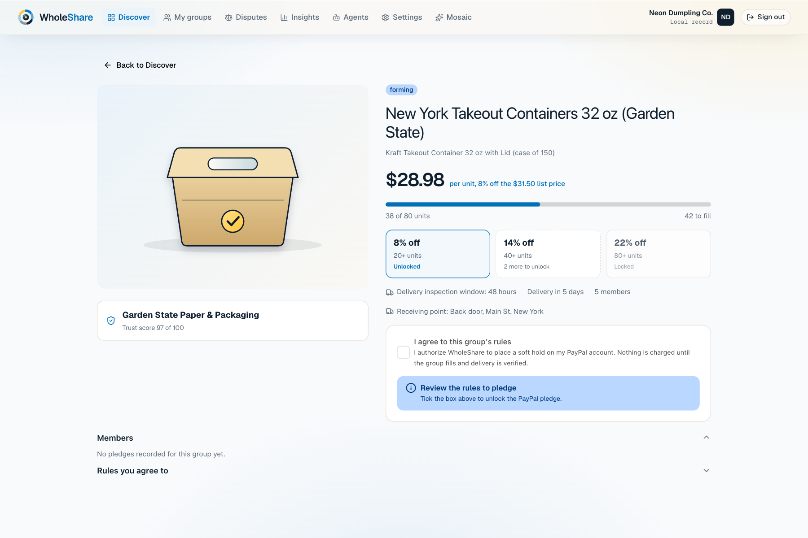
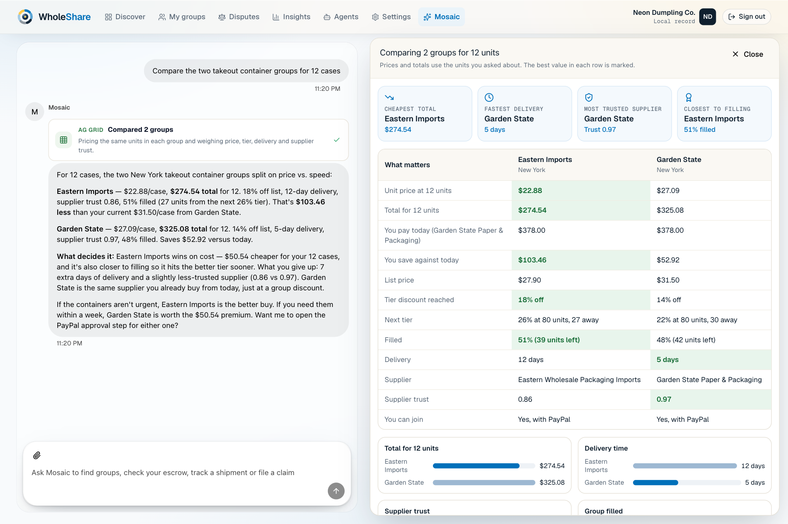
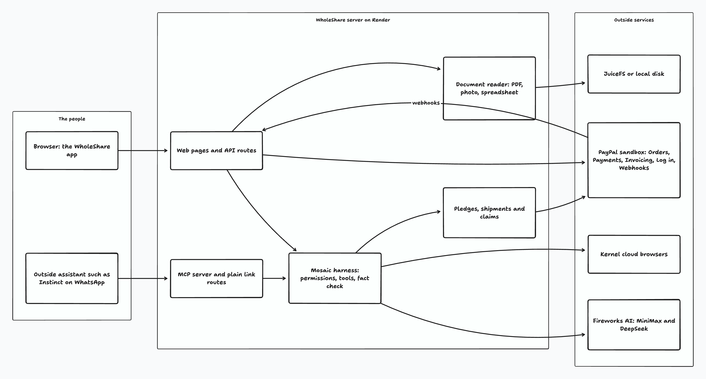

# WholeShare

**Small businesses pool their orders to reach supplier price tiers. An AI assistant does the legwork. PayPal holds the money until the goods arrive in good shape.**

Live app: https://wholeshare-app.onrender.com

> Everything runs in the **PayPal sandbox**. No real money moves. The groups, members and suppliers in the demo market are sample data, and the app says so.



## What WholeShare does

A dumpling restaurant and a bubble tea shop on the same street both buy the same takeout boxes. The supplier's price drops at 80 cases. Neither shop will ever order 80 cases alone, so both overpay.

Ordering together is the obvious fix, and it rarely happens. Three questions get in the way. Whose door does the order go to? Who pays what? Who covers the loss if half the boxes arrive crushed?

WholeShare answers all three.

1. **You start with your paperwork.** Drop in a supplier invoice and an inventory sheet. WholeShare reads them and fills in your business, your supplier and what you pay today. It keeps a value only if the value is written in your documents.
2. **You find a group.** The app already knows what you buy. It shows matching groups with the price at your volume, the discount tier, the delivery time and how much the supplier can be trusted.
3. **You pledge through PayPal.** You approve on PayPal's own screen. PayPal places a hold on the money. Nothing is charged.
4. **Mosaic does the legwork.** Mosaic is the assistant inside the app. Ask it to compare two groups, find new suppliers on the web, or start a group from one sentence.
5. **You check the goods.** Deliveries show on a timeline and a calendar, with a 48 hour inspection window. Accept the goods and the held money goes to the supplier.
6. **If something is wrong, you file a claim.** Describe what happened and attach a photo. The refund covers only the damaged units.

One rule sits under everything. The assistant can prepare any step, but only a person can approve a payment.



## Try it

1. Open https://wholeshare-app.onrender.com.
2. Choose **Use your business**, then **Use the Neon Dumpling sample documents**. WholeShare reads the invoice and the inventory sheet.
3. Open **Mosaic** and ask `Compare the two takeout container groups for 12 cases`.

The full walkthrough, with the PayPal sandbox buyer login, is in [docs/TESTING.md](docs/TESTING.md).

## How WholeShare uses PayPal

PayPal is the trust layer. The design depends on PayPal's authorize-then-capture flow: money is held first and released only when the goods are right.

**A pledge becomes a hold.** The app creates a PayPal order with the intent set to `AUTHORIZE`. The person approves it in PayPal's window, opened by the PayPal JavaScript SDK v6 button on the group page. Then the server authorizes the order. That authorization is the hold.

**The hold is released, or reduced, when the goods arrive.** When the person accepts the goods, the server captures the hold. If some units are damaged, it captures only the intact units and releases the rest. If the money was already captured, it refunds the damaged units. A hold that is not used can be voided.

**Larger pledges start with an invoice.** A pledge of $1,000 or more first gets a PayPal invoice with a QR code, through Invoicing v2.

**The business signs in with PayPal.** Log in with PayPal connects the business's PayPal identity during onboarding.

**PayPal's events are trusted only after they are verified.** The webhook handler checks PayPal's signature and certificate before any event can change a claim. Events that arrive out of order, such as a capture before its order, wait in a buffer until their order exists.

**Money is handled with care.**
- Every amount is a whole number of cents.
- Every call that changes money carries an idempotency key, so a retry never pays twice.
- A reconciliation worker re-checks operations that are still pending and flags the ones that need a person.
- A spend limit applies to every pledge.

**Outside assistants cannot approve money either.** An assistant such as Instinct on WhatsApp can ask for a PayPal approval link through the `request_pledge_approval` tool. The owner opens the link and approves on PayPal.

The rest of PayPal's platform is in the code too: Shipment Tracking, Payouts to suppliers, Billing subscriptions for group dues, Disputes offers, and the PayPal Agent Toolkit connected through our interceptor.

**What has run live, and what has not.** In the PayPal sandbox we have run the hold, the PayPal button, invoices and Log in with PayPal. Capture, refund, void, payouts, shipment tracking, billing and disputes are written and covered by tests that use stand-ins for PayPal. We have not run them live yet. Files to read: `src/lib/paypal-checkout.js`, `src/lib/paypal-bridge.js`, `src/lib/pledge-ledger.js`, `src/gateway/` and `src/daemon/reconciliation.worker.ts`.

## How WholeShare uses AI

**Mosaic, the assistant.** Mosaic runs on Fireworks AI. The main model is MiniMax M3.1 Flash, served serverless with its thinking turned off so it answers quickly. DeepSeek V4.1 Flash is the backup. If the first model has not answered in five seconds, the same request also goes to the backup and the first answer wins.

**The harness around the model.** We wrote our own harness, so the model never acts on its own. It does five things:
- It decides which tools the model may use.
- It checks every argument on the server before a tool runs.
- It limits each turn to five tool calls.
- It checks every number and name in the reply against what the tools returned, and asks for a rewrite when something does not match.
- It follows five permission switches that the person controls: search and filter, prepare quotes, draft messages and claims, research suppliers, and change schedules. All five start off.

**Reading documents.** PDFs are read with `unpdf`, phone photos with `tesseract.js` OCR, and spreadsheets with `xlsx`. The model pulls out the fields, and the server drops any value that is not written in the document.

**The web.** Kernel cloud browsers read real supplier websites for prices, minimum orders and lead times. They only read, and never submit a form. Web results are labelled unverified.

**Three ways in.** The same tools can be used from three places.
- *Inside the app.* Mosaic is built in. An in-page tool set, declared through WebMCP, lets an agent in the browser filter, sort, chart and reschedule what is on screen.
- *From any MCP client.* WholeShare runs an MCP server at `/mcp`. An outside agent connects with an invite token and follows the same permission switches.
- *From a plain link.* An assistant that can only open links, such as Instinct on WhatsApp, uses two link routes: `/api/v1/agent/<token>/ask` and `/api/v1/agent/<token>/clans`.

**Our own open model.** Fireworks AI with MiniMax and DeepSeek powers the live app today. We also trained our own model, so you can run WholeShare without depending on anyone's servers.
- *What it is.* LoRA adapters for Qwen3.5 (4B and 9B), tuned to use WholeShare's tools correctly. Model: [model link].
- *How we trained it.* We used on-policy self-distillation. The model tries a task, a strict rule checker flags its mistakes, and a teacher copy of the model explains the fix without seeing private data. The corrected answer becomes new training data.
- *The dataset.* The Kaggle dataset `wholeshare-opsd-dataset`: [Kaggle dataset link]. It is ordered like a course, from sourcing to escrow to disputes, with every amount in whole cents. We mixed in 15 percent general finance questions (FinQA and TAT-QA) so the model keeps its everyday money math.
- *The notebooks.* The Kaggle notebooks that train the adapters are in [`training/`](training/).
- *How to run it.* Start any OpenAI-compatible server that loads the base model and the adapter. Then set `MOSAIC_PROVIDER=custom` and `MOSAIC_MODEL_URL` to that server, and restart WholeShare.
- *What we have and have not measured.* We have only small checks of the tuned model. We have not compared it with MiniMax, so the hosted app uses MiniMax and DeepSeek.

**How reliable is Mosaic?** We ran 100 new prompts across ten jobs, with 30 held back that we never tuned against. Mosaic passed 97 percent of all of them and 97 percent of the held back set. The method and results are in [docs/assets/mosaic-eval.md](docs/assets/mosaic-eval.md).

## Tools and sponsors

| Tool | What it does here |
|---|---|
| PayPal (sandbox) | Holds, captures, refunds, invoices, sign-in and webhooks. See above. |
| Fireworks AI | Runs Mosaic (MiniMax M3.1 Flash, with DeepSeek V4.1 Flash as backup) and reads documents. |
| AG Grid Enterprise, AG Charts | The tables and charts beside the chat, with sorting, grouping, export and integrated charts. |
| AG Studio | The Insights reports: money held on PayPal, demand and savings, deliveries and claims. The assistant can edit them. |
| Bryntum | Scheduler for deliveries, Calendar for inspection windows, TaskBoard for the claims board. |
| Kernel | Cloud browsers for supplier research. |
| MCP and WebMCP | How outside agents and in-browser agents use WholeShare. |
| JuiceFS | Stores uploaded documents when its drive is mounted. Otherwise a local disk is used. |
| Render | Hosts the app. |
| React, Node.js, TypeScript, esbuild | The app itself. |

AG Grid Enterprise, AG Studio and Bryntum are commercial products. The code in this repository is MIT licensed, but you need your own licence keys for those three to run the app without a watermark.

## How it fits together



The browser talks to one Node server. The server holds the harness, the ledger of pledges, shipments and claims, and the document reader. It calls PayPal, Fireworks and Kernel. [docs/ARCHITECTURE.md](docs/ARCHITECTURE.md) explains each part and shows the money flow, the harness and the outside-agent path.

## Run it yourself

You need Node.js 24 or newer, a free [PayPal developer](https://developer.paypal.com) account with a sandbox app, and an API key for a model (Fireworks AI, or any OpenAI-compatible server).

1. Install the packages.
   ```bash
   npm ci
   ```
2. Copy the settings file and fill it in.
   ```bash
   cp .env.example .env
   ```
   At least set `PAYPAL_CLIENT_ID`, `PAYPAL_CLIENT_SECRET` and `FIREWORKS_API_KEY`. The table below lists the rest.
3. Build the browser bundle.
   ```bash
   npm run build
   ```
4. Start the app.
   ```bash
   npm start
   ```
5. Open http://localhost:3000.

The server refuses to start without PayPal sandbox keys rather than faking a payment gateway.

| Setting | What it does |
|---|---|
| `PAYPAL_MODE`, `PAYPAL_CLIENT_ID`, `PAYPAL_CLIENT_SECRET`, `PAYPAL_BASE_URL` | Your PayPal sandbox app. |
| `PAYPAL_WEBHOOK_ID` | Lets the server verify PayPal's webhooks. |
| `APP_URL` | The public address of the app. In the PayPal developer dashboard, turn on Log in with PayPal and add `<APP_URL>/api/v1/paypal/connect/callback` as a return URL. Add a webhook that points to `<APP_URL>/api/v1/paypal/webhook`. |
| `MOSAIC_PROVIDER`, `MOSAIC_MODEL_NAME`, `FIREWORKS_API_KEY` | The model Mosaic uses. `fireworks`, `openai`, `openrouter`, `local` or `custom`. |
| `MOSAIC_MODEL_URL` | Address of your own model server, when the provider is `custom`. |
| `MOSAIC_FALLBACK_MODEL`, `MOSAIC_HEDGE_MS` | The backup model and how long to wait before asking it. |
| `MOSAIC_DEV_BUDGET_USD` | A spend limit for hosted model calls. The app stops calling the model when it is used up. |
| `KERNEL_API_KEY` | Kernel cloud browsers. Without it, supplier research from the web is switched off. |
| `AG_LICENSE_KEY`, `AG_STUDIO_LICENSE_KEY`, `BRYNTUM_LICENSE_KEY` | Licence keys for AG Grid, AG Studio and Bryntum. They are read when you build. |
| `SYNDICATE_HMAC_SECRET` | A long random string used to sign tokens. Generate your own. |

Never commit `.env`. The repository ignores it.

**Deploy on Render.** `render.yaml` describes one Node web service with a 1 GB disk and no database. Pick the Starter plan, which stays on, and add the settings above as environment variables. `scripts/render-start.sh` keeps the app's saved state on the disk.

**Run the checks.**
```bash
npm run lint
npm run test:unit        # 226 unit tests
npm run verify:ui        # opens every screen at two sizes and fails on clipped controls
npm run verify-webmcp    # checks the in-page agent tools
npm run eval:mosaic      # the 100 prompt reliability test, needs a model key
```

## Project layout

```
src/
  web/            Node server and the React app
  lib/            Mosaic harness, tools, PayPal and ledger code, document reader, MCP server
  gateway/        PayPal gateway and webhook verification
  adapter/        Claims, delivery, settlement and dispute steps
  domain/         Money math in whole cents and the group and member states
  daemon/         Reconciliation worker for pending PayPal operations
  storage/        Saved state: claims, deliveries, idempotency records
data/             Sample market: groups, suppliers, cities
schema/           Database schema and the OpenAPI description
training/         Kaggle notebooks that train the open model
test/             Unit tests
scripts/          Checks, the reliability test, data generators, demo recording tools
docs/             Architecture, testing guide, harness notes, diagrams, screenshots
```

## Limits, stated plainly

- The groups, members and directory suppliers are generated sample data. Web leads from Kernel are real pages but unverified. PayPal invoices and orders are real sandbox objects.
- PayPal runs in the sandbox only. Capture, refund, void, payouts, tracking, billing and disputes have not run live.
- The demo shares one workspace. If two people use the live site at once, they see each other's changes.
- A reply from Mosaic takes five to eight seconds. Supplier research from the web can take twenty seconds or more.
- Mosaic can be wrong about a photo, and it tends to agree with what the person says about damage. Claims stay drafts for a person to review.
- The in-page agent tools are checked by our own verifier. We have not tested them in a browser that ships native WebMCP.
- The app is built for a laptop screen. Phone widths are not supported.

## License

[MIT](LICENSE). AG Grid Enterprise, AG Studio and Bryntum have their own licences. Image credits are in [docs/IMAGE_SOURCES.md](docs/IMAGE_SOURCES.md).
