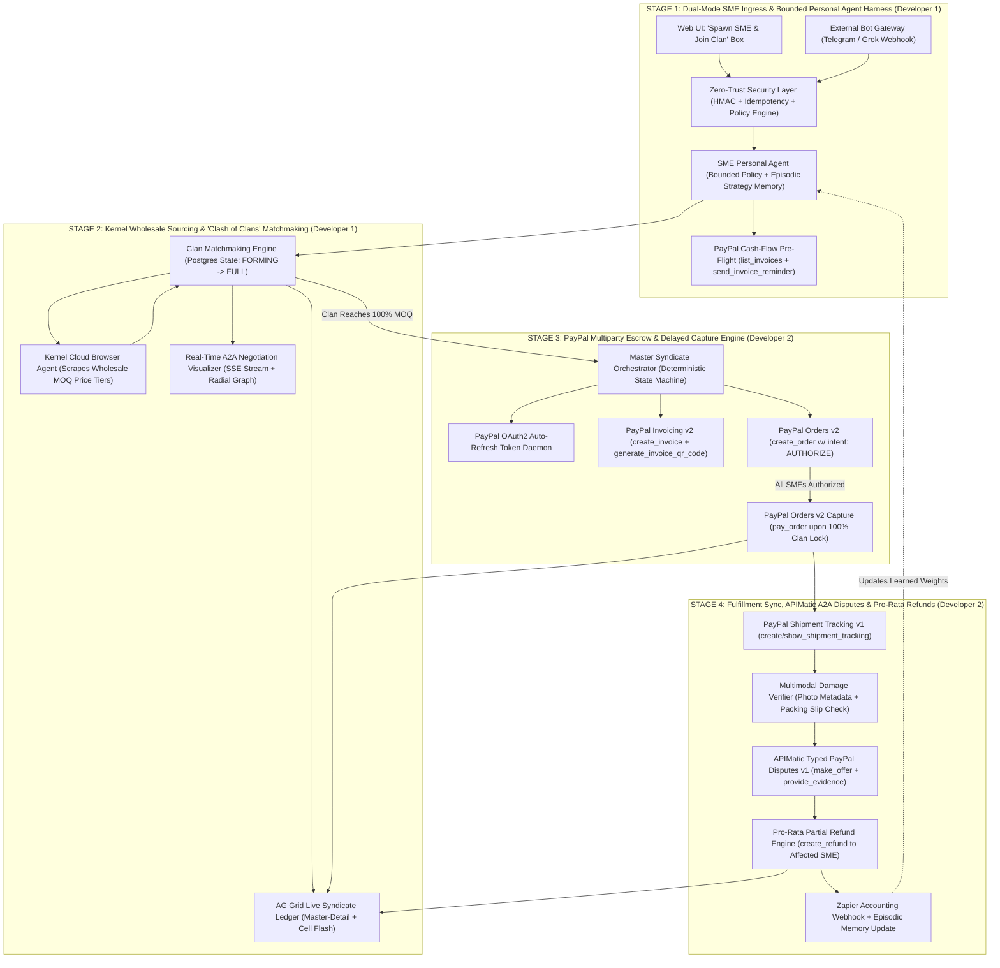
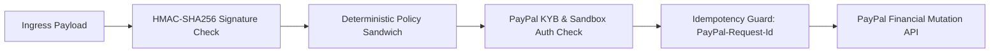
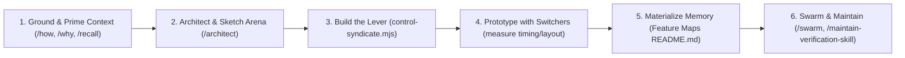
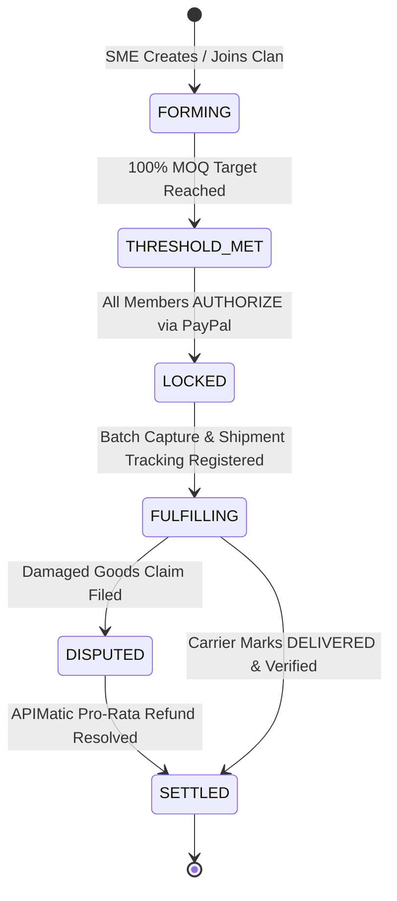

# WHOLESHARE: Master Architecture, Security & `pstack` Agentic Design Document

> **System Blueprint & Technical Specification**  
> *Targeted for the PayPal AI Hackathon & Co-Sponsor Tracks (AG Grid, APIMatic, Kernel, Render, pstack)*  
> *Author: Wholeshare Engineering Architecture Team*  
> *Version: 1.0.0-PROD | Status: Approved Architecture Blueprint*

---

## 1. Executive Context, Hackathon Links & Sponsor Matrix

### 1.1 Product Thesis & Problem Statement
Small and Medium Enterprises (SMEs) face an unfair structural disadvantage when purchasing operational inventory (e.g., eco-packaging, raw baking ingredients, wholesale electronics). Suppliers offer substantial volume discounts—often 30% to 50% lower unit prices—at high Minimum Order Quantities (MOQs) that individual SMEs cannot afford alone. Today, forming group-buying syndicates is hindered by:
1. **Coordination Chaos:** Manual negotiation across chat channels, phone calls, and email threads.
2. **Counterparty Credit Risk:** Fear that co-purchasers will default on their share of the invoice.
3. **Escrow Friction:** High fees, legal paperwork, and delayed settlement mechanisms.
4. **Post-Fulfillment Disputes:** Inability to isolate and resolve a single damaged shipment without freezing the entire group order.

**Wholeshare** solves this through a *"Clash of Clans"*-style B2B Group Purchasing & Multiparty Escrow Platform built on **PayPal for Business**. SME owners delegate procurement to their **Personal Agents** in natural language. These agents autonomously discover or form **Purchasing Clans (Syndicates)**, deploy **Kernel** cloud browsers to scrape and verify live B2B tier pricing, secure pro-rata funds with zero upfront lock-in using **PayPal Orders (`intent: "AUTHORIZE"`)** and **PayPal Invoices (`create_invoice`, `generate_invoice_qr_code`)**, execute atomic batch settlement upon MOQ unlock, and autonomously resolve damaged shipment claims via **PayPal’s Customer Disputes API**—all rendered live inside an **AG Grid** financial command center and a real-time **A2A (Agent-to-Agent) Negotiation Arena**.

---

### 1.2 Official Competition & Sponsor Resource Directory

| Entity / Prize Track | Official Developer Resources & Documentation | Architectural Integration & Judge Satisfaction |
| :--- | :--- | :--- |
| **PayPal AI Hackathon**<br>*(Grand Prize: $12k \| Agentic Commerce: $5k \| PayPal+AI: $5k \| Demo: $5k)* | • Portal: [paypalaihackathon.devpost.com](https://paypalaihackathon.devpost.com/)<br>• Developer Docs: [developer.paypal.com/docs/api](https://developer.paypal.com/docs/api/overview/)<br>• PayPal Agent Toolkit (TS/MCP): [github.com/paypal/agent-toolkit](https://github.com/paypal/agent-toolkit)<br>• Orders v2 API: [developer.paypal.com/docs/api/orders/v2](https://developer.paypal.com/docs/api/orders/v2/)<br>• Invoicing v2 API: [developer.paypal.com/docs/api/invoicing/v2](https://developer.paypal.com/docs/api/invoicing/v2/)<br>• Disputes v1 API: [developer.paypal.com/docs/api/customer-disputes/v1](https://developer.paypal.com/docs/api/customer-disputes/v1/)<br>• Tracking v1 API: [developer.paypal.com/docs/api/tracking/v1](https://developer.paypal.com/docs/api/tracking/v1/) | Chains **6 native PayPal Business primitives** (`list_invoices`, `send_invoice_reminder`, `create_invoice`, `generate_invoice_qr_code`, `create_order` w/ `AUTHORIZE`, `pay_order`/capture, `create_shipment_tracking`, `customer-disputes`) inside a deterministic multi-agent state machine. Moves far beyond standard 1-click checkout buttons. |
| **AG Grid**<br>*($5k 1st \| $2k 2nd \| $1k 3rd — Judge: Sylwia Vargas)* | • AG Grid React Docs: [ag-grid.com/react-data-grid](https://www.ag-grid.com/react-data-grid/)<br>• Master-Detail & Cell Flash: [ag-grid.com/.../change-cell-renderers](https://www.ag-grid.com/react-data-grid/change-cell-renderers/) | Powers the **Live Clan Order Book & Escrow Matrix**. Uses Master-Detail expansion (Clan Master -> SME Details), live cell flashing (`enableCellChangeFlash`), tier-drop progress bars, and dynamic pro-rata dispute settlement updates. |
| **APIMatic**<br>*($1k x 3 Category Winners)* | • Docs & SDK Portal: [apimatic.io](https://www.apimatic.io/)<br>• Developer Hub: [docs.apimatic.io](https://docs.apimatic.io/) | Generates strongly-typed TypeScript SDK wrappers and Zod validation schemas from PayPal OpenAPI specifications (`/v1/customer/disputes`, `/v2/checkout/orders`), guaranteeing zero LLM hallucination of financial payloads. |
| **Kernel**<br>*($50 Cloud Browser Credits)* | • Platform: [onkernel.com](https://www.onkernel.com/)<br>• Documentation: [docs.onkernel.com](https://docs.onkernel.com/) | Powers the **Wholesale Sourcing Agent**, spinning up headless cloud browser sessions to scrape live B2B wholesale MOQ pricing tables (Tier 1 vs Tier 2 vs Tier 3) with screenshot proofs cached in PostgreSQL. |
| **Render**<br>*($50 Credits + $1k Category Prize — Judge: Shifra Williams)* | • Docs: [render.com/docs](https://render.com/docs)<br>• Blueprint Spec: [render.com/docs/infrastructure-as-code](https://render.com/docs/infrastructure-as-code) | Deploys our persistent Next.js application, Node/TS background orchestrator, and PayPal webhook listener as an Infrastructure-as-Code blueprint (`render.yaml`), running on a dedicated starter service. |
| **pstack & Dr Eggbot**<br>*(Agentic Engineering Harness)* | • pstack Plugin: [x.ai/bot/plugin/9717366](https://x.ai/bot/plugin/9717366)<br>• Dr Eggbot: [x.ai/bot/93gOz3op1UQdBdbekQFLK](https://x.ai/bot/93gOz3op1UQdBdbekQFLK)<br>• Verification Repo: [github.com/poteto/verification-skill-example](https://github.com/poteto/verification-skill-example) | Implements the **Verification CLI (`control-syndicate.mjs`)**, Materialized Memory Feature Maps, `/architect` arenas, and the `/poteto-mode` prototyping loop for autonomous agentic verification. |
| **Postman & Zapier**<br>*(Ecosystem Integrations)* | • Postman PayPal Workspace: [postman.com/paypal](https://www.postman.com/paypal)<br>• Zapier Webhook Integrations: [zapier.com/apps/webhook](https://zapier.com/apps/webhook/integrations) | Exports a 1-click verifiable Postman Collection (`wholesharepal.postman_collection.json`) and triggers Zapier accounting webhooks (QuickBooks/Xero sync) upon Clan batch settlement. |

---

## 2. Master High-Level Architecture Diagram

Copy the Mermaid code block below and paste it directly into **Excalidraw** (`More Tools` -> `Mermaid to Excalidraw`) or **tldraw** to generate an interactive, editable canvas for pitch decks, architecture reviews, and team onboarding:



---

## 3. Flow-by-Flow Engineering & Verification Blueprint

Every stage is structured around **Build What** and **Verify How** so any coding agent can inspect, execute, and assert state transitions without manual intervention.

### Flow 1: Dual-Mode SME Ingress & Bounded Personal Agent (Stage 1 — Developer 1)
* **What to Build:**
  1. **Unified SME Onboarding Endpoint (`POST /api/sme/spawn`):** Ingests natural language prompts (e.g. *"Austin Bakery needing 200kg organic flour, max budget $300"*) or signed Telegram/Grok Bot webhook events.
  2. **Bounded Policy Engine:** Writes a strict policy record in PostgreSQL (`max_auto_authorize_usd`, `min_tier_discount_pct`, `require_qr_approval_above_usd`).
  3. **PayPal Cash-Flow Pre-Flight:** Calls `@paypal/agent-toolkit`'s `list_invoices` to verify SME liquidity and automatically fires `send_invoice_reminder` for overdue receivables.
* **How to Verify:**
  ```bash
  node .cursor/skills/verify-syndicate/control-syndicate.mjs spawn-sme \
    --name "Austin Artisan Bakery" --sku "organic-flour-50lb" --qty 15 --max-usd 450
  ```
  *Assertion:* Returns HTTP 200, valid `sme_id`, policy JSON, and simulated `list_invoices` log.

### Flow 2: Kernel Wholesale Sourcing & "Clash of Clans" Matchmaking (Stage 2 — Developer 1)
* **What to Build:**
  1. **Kernel Sourcing Worker:** Dispatches a headless cloud browser session to scrape B2B wholesale MOQ tiers (Tier 1: 100 @ $10; Tier 2: 500 @ $7.20; Tier 3: 1,000 @ $5.80) and caches screenshot proofs in PostgreSQL.
  2. **Clan Matchmaking Engine:** Groups SME agents into Clan instances (`FORMING` &rarr; `THRESHOLD_MET`) and streams real-time negotiation events over SSE.
* **How to Verify:**
  ```bash
  node .cursor/skills/verify-syndicate/control-syndicate.mjs match-clan \
    --sku "organic-flour-50lb" --simulate-agents 3
  ```
  *Assertion:* Clan status transitions to `THRESHOLD_MET` (500 units), discount cell updates to 28%.

### Flow 3: PayPal Multiparty Escrow via Order Authorization & Invoicing (Stage 3 — Developer 2)
* **What to Build:**
  1. **Auto-Refreshing PayPal OAuth2 Daemon:** Manages token lifecycle against PayPal Sandbox without service interruption.
  2. **Multiparty Escrow Lock (`AUTHORIZE`):** Generates PayPal Invoices and invoice QR codes (`create_invoice` + `generate_invoice_qr_code`) and creates individual order authorizations (`create_order` with `intent: "AUTHORIZE"`) for each member's pro-rata share.
  3. **Atomic Batch Capture Engine:** Executes `pay_order` (capture) only when 100% of Clan members reach status `AUTHORIZED`. Supports late-joiner price drops via instant dynamic rebates (`create_refund`).
* **How to Verify:**
  ```bash
  node .cursor/skills/verify-syndicate/control-syndicate.mjs lock-escrow \
    --clan-id "clan_flour_01" --dry-run false
  ```
  *Assertion:* Outputs 3 PayPal Sandbox Order IDs in `COMPLETED` status, valid QR URLs, and $3,600 captured.

### Flow 4: Fulfillment Sync & APIMatic A2A Disputes (Stage 4 — Developer 2)
* **What to Build:**
  1. **PayPal Shipment Tracking Sync:** Registers and polls carrier tracking numbers via `create_shipment_tracking`.
  2. **APIMatic-Typed Dispute Mediator:** Built from PayPal's Customer Disputes v1 OpenAPI spec. Verifies the 48-hour delivery window, submits damage photo hashes via `provide_evidence`, negotiates a partial refund via `make_offer`, and triggers `create_refund` for the affected SME ($300) while releasing $3,300 to the supplier.
  3. **Zapier Accounting Sync:** Dispatches final settlement webhooks to Zapier for ERP ledger updates.
* **How to Verify:**
  ```bash
  node .cursor/skills/verify-syndicate/control-syndicate.mjs trigger-dispute \
    --clan-id "clan_flour_01" --sme-index 2 --damage-pct 25
  ```
  *Assertion:* Returns PayPal Dispute ID, Refund Transaction ID, and updates the AG Grid row to reflect -$300 refund.

---

## 4. Two-Developer Team Division & 20-Day Execution Plan

Work is divided strictly along **Stages 1–2 (Developer 1)** and **Stages 3–4 (Developer 2)**, interfacing exclusively through the PostgreSQL database schema.

| Sprint Phase | Developer 1 (Stages 1 & 2)<br>*Agent Harness, Kernel Scraper, Clan Lobby & AG Grid* | Developer 2 (Stages 3 & 4)<br>*PayPal Escrow, APIMatic Disputes, Tracking & Render* |
| :--- | :--- | :--- |
| **Days 1–3: Setup & Harness** | • Scaffold Next.js App Router + Prisma/Postgres.<br>• Run `/create-verification-skill` to generate `control-syndicate.mjs`.<br>• Define Prisma models for `Clan` and `ClanMember`. | • Set up `@paypal/agent-toolkit` Sandbox credentials.<br>• Generate TypeScript SDKs using APIMatic on PayPal OpenAPI specs.<br>• Build auto-refreshing OAuth2 token middleware. |
| **Days 4–8: Core Engines** | • Build SME Onboarding endpoint (`POST /api/sme/spawn`).<br>• Implement Bounded Policy Engine and Telegram webhook.<br>• Build Kernel Cloud Browser scraper worker with fallback cache. | • Build Escrow Orchestrator (`create_invoice`, QR codes, `create_order` w/ `AUTHORIZE`).<br>• Build atomic batch capture daemon (`pay_order`).<br>• Implement dynamic tier-drop refund logic. |
| **Days 9–14: UI & Disputes** | • Build "Clash of Clans" Syndicate Lobby with MOQ progress bars.<br>• Implement A2A Negotiation Arena (radial graph + SSE stream).<br>• Build AG Grid Master-Detail Ledger with `enableCellChangeFlash`.<br>• Add Judge God-Mode Simulator Bar. | • Build Shipment Tracking sync (`create/show_shipment_tracking`).<br>• Implement APIMatic Dispute flow (`provide_evidence`, `make_offer`, pro-rata refund).<br>• Wire Zapier accounting webhook & export Postman collection. |
| **Days 15–20: Hardening & Demo** | • Run `/poteto-mode` and `/swarm` to fuzz UI state transitions.<br>• Capture proof screenshots via `control-syndicate.mjs`.<br>• Polish CSS, responsive styling, and animations. | • Deploy production blueprint on Render (`render.yaml`).<br>• Configure database keep-alive cron job.<br>• Record and edit the 2:45 hackathon video walkthrough. |

---

## 5. Enterprise FinTech Cybersecurity & Anti-Fraud Architecture

Fintech judges at PayPal evaluate security rigor and defensive engineering above all else. Wholeshare embeds **six foundational security guardrails**:



1. **Prompt-Injection Firewall & Deterministic Policy Sandwich:**
   LLMs never invoke PayPal mutation APIs with unconstrained arguments. Every tool call passes through a deterministic validator checking:
   `orderAmount <= smePolicy.max_auto_authorize_usd` and `unitPrice <= clan.initialWholesalePrice`.
   Violations halt execution in code before reaching PayPal.
2. **Sybil & Phantom-Clan Prevention (Verified PayPal KYB Binding):**
   Prevents fraudulent suppliers from spinning up fake SME agents. Every joining SME must hold a verified PayPal account and sign an `AUTHORIZE` hold before their pledged units count toward the Clan threshold. Unbacked pledges remain `UNVERIFIED_INTENT`.
3. **Cryptographic Webhook Verification:**
   PayPal webhooks verify `PAYPAL-TRANSMISSION-SIG` and cert headers against PayPal's verification endpoint. External Telegram/Grok webhooks require `X-Syndicate-HMAC-SHA256` signatures with a 300-second replay window.
4. **Deterministic Idempotency Keys (`PayPal-Request-Id`):**
   Every call to `create_order`, `pay_order`, `create_invoice`, and `create_refund` includes a deterministic `PayPal-Request-Id: hash(clan_id + sme_id + stage)` header, guaranteeing exactly-once execution.
5. **Multimodal Dispute Evidence Tamper Detection:**
   Dispute damage photos undergo SHA256 perceptual hashing to prevent evidence reuse. Delivery timestamps are cross-referenced with PayPal Shipment Tracking to reject claims filed before delivery or outside the 48-hour inspection window.
6. **Human-in-the-Loop Step-Up via PayPal QR Code:**
   Transactions exceeding the SME's auto-spend cap trigger `generate_invoice_qr_code` and present a scannable PayPal QR code for cryptographic owner authorization.

---

## 6. The `pstack` Agentic Engineering Master Handbook

Following the methodology established by Lauren (`@poteto`) on Grok Bot and Cursor, software quality and velocity compound exponentially when agents possess the infrastructure to verify their own work autonomously.



### 6.1 The Engineering Philosophy: Supervising Someone Smarter Than You
In the agentic era, frontier models write syntax faster than humans, but fail in two consistent modes: **under-specified intent** and **lack of context**. Operating effectively requires shifting from micromanagement to architecture and constraint design—acting as the "gardener" who tends code smells, maintains organic architecture, and establishes automated feedback loops. When an agent can verify its own work, human babysitting is eliminated, allowing developers to land thousands of high-quality PRs with zero downtime.

### 6.2 Context Priming & Mental Models
* **Indirect Prompting (`/in-your-own-words`):** When an ambiguous requirement or bug arrives, instruct the agent to restate the problem in its own words before writing code. This forces compression, exposes false assumptions early, and prevents leading the agent down unproductive paths.
* **Building Mental Models via `/teach`:** Calls `/how` (tracing runtime mechanics across subsystems in parallel) and `/why` (investigating historical decisions across Git history, PR comments, Slack discussions, and telemetry) to provide deep grounding.
* **Learning from History via `/recall`:** Instead of starting from scratch in each new chat session, `/recall` extracts working context from previous conversation transcripts, preserving hard-won domain knowledge.

### 6.3 Working Backwards & Readme-Driven Development (The Diátaxis Framework)
Before implementing complex features, draft the documentation first. Using the `/technical-writing` and `/unslop` skills, documentation is separated into four distinct modes:
1. **Tutorial:** Learning by doing. Step-by-step guidance producing visible results immediately.
2. **How-To Guide:** Practical steps solving a specific real-world operational problem.
3. **Reference:** Dry, complete, and authoritative descriptions of APIs, flags, and schemas.
4. **Explanation:** High-level discussion illuminating design choices, history, and architectural tradeoffs.

### 6.4 "Measure a Hundred Times, Cut Once" — The Prototyping Playbook
Abstract plans create an illusion of progress but lack empirical grounding. Under `pstack`'s Prototyping Playbook, agents plan through throwaway code. When designing novel UI interactions or algorithms, the agent builds 2–3 competing variations behind a feature switcher, drives them programmatically using the verification CLI, and measures layout metrics, rendering times, and error rates to select the superior design based on empirical proof.

### 6.5 The `/architect` Arena Workflow
For non-trivial architectural changes crossing module boundaries, the agent executes five disciplined phases:
1. **Ground:** Run `/how` and `/why` over affected subsystems to map ownership and constraints.
2. **Sketch:** Spawn parallel candidate runners across different model families to draft caller usage, core types, and public signatures.
3. **Cross-Judge & Synthesize:** An independent judge model evaluates candidates against an interface depth and red-flag rubric.
4. **Implement:** Populate placeholder logic against the validated sketch.
5. **Scrap:** If forced casts, `any` escape hatches, or recurring workarounds emerge during implementation, throw away the sketch and start over.

### 6.6 "Build the Lever" — The `control-syndicate.mjs` CLI Specification
Following John Ousterhout's *deep modules* philosophy, the verification CLI provides an expansive capability matrix through a compact command surface:
* `doctor`: Health check verifying PostgreSQL, PayPal OAuth tokens, Kernel keys, and port 3000.
* `seed-demo`: Creates deterministic test fixtures (3 SME Personas, 2 Clans, cached Kernel pricing) with `--reset` support.
* `spawn-sme`: Onboards an SME with bounded policy validation and automated AR cash-flow reminders.
* `match-clan`: Simulates A2A matchmaking until the Clan hits the 100% MOQ unlock threshold.
* `lock-escrow`: Executes PayPal Sandbox Order Authorizations and atomic batch Capture (with mandatory `--dry-run` support).
* `trigger-dispute`: Validates delivery tracking, submits damage evidence hashes, and settles pro-rata refunds.
* `snapshot` & `screenshot`: Captures live accessibility trees (ARIA) and high-resolution viewport images.
* `wait-settle`: Waits for active Server-Sent Events (SSE) and asynchronous database transactions to settle.

### 6.7 Materialized Memory: Feature Maps (`references/features/`)
Code is the ultimate source of truth. Feature maps catalog every user journey into token-efficient markdown documents structured with four mandatory H2 headers: `Sub-features`, `How to get to it (user POV)`, `Driving it with control-syndicate`, and `Gotchas`. Agents reference these maps to navigate the application without wasting context window tokens.

### 6.8 Cloud Agents vs. Worktrees & Parallel Swarms
While local git worktrees consume excessive disk space and memory (capping concurrency at ~10 agents), Cursor cloud agents run on dedicated cloud machines with pre-warmed snapshot builds. This unlocks massive parallelism via `/swarm`, enabling agents to fan out dozens of workers to fuzz UI state machines, run statistical performance benchmarks, and automatically reproduce user bug reports.

### 6.9 Concrete Agentic Prompts & Real-World Playbooks
```bash
# Example 1: Researching an ambiguous bug
/poteto-mode investigate why PayPal batch capture periodically stalls.
restate the issue in your own words first, trace execution with /how, and give me your top 3 hypotheses.

# Example 2: Designing a new service boundary
/poteto-mode we need to add rate-limiting for external bot webhooks.
/architect this across candidate runners, sketch the type signatures first, and test with throwaway prototypes.

# Example 3: Executing a multi-PR migration
/poteto-mode plan a migration of our dispute engine to APIMatic typed SDKs.
break into small verifiable PRs. each unit must be provable via /control-syndicate before landing.

# Example 4: Automatic bug reproduction
/poteto-mode repro this dispute settlement calculation failure using control-syndicate.mjs.
if reproducible on main, fix the root cause and provide a screenshot proof of the green AG Grid row.
```

---

## 7. High-Impact UI/UX & Real-Time Visualization Blueprint

To win design and demo delivery awards, Wholeshare organizes the screen into **four synchronized visual zones**:

1. **ZONE 1: Sticky Top Bar — Judge God-Mode Simulator & Security Telemetry**
   - 4 Sequential 1-Click Buttons: `[1. Spawn SME & Scrape Tiers]`, `[2. Form Clan & Matchmake]`, `[3. Lock PayPal Escrow ($3,600)]`, `[4. File Dispute (-$300)]`.
   - Live Security Telemetry Badges: `OAuth2: ACTIVE`, `HMAC: ENFORCED`, `Policy Cap: <=$1,000`, `Kernel: READY`.
2. **ZONE 2: Top-Left (35% Width) — "Clash of Clans" Syndicate Lobby**
   - Clan Strategy Cards with unit counters (`350 / 500 units pledged`).
   - Tier Progress Rings: Tier 1 ($10) &rarr; Tier 2 ($7.20 — UNLOCKED!) &rarr; Tier 3 ($5.80).
   - Natural Language Spawner Box + "Connect Grok/Telegram Bot" Ingress Drawer.
3. **ZONE 3: Top-Right (65% Width) — Live A2A Negotiation & Deal Arena**
   - Radial Node Graph: Center Orchestrator + SME Nodes + Kernel + Wholesale Supplier.
   - Animated glowing particle pulses along active negotiation edges.
   - Speech Bubbles: Plain English intent + Expandable APIMatic JSON payloads.
4. **ZONE 4: Bottom Panel (100% Width) — AG Grid Live Syndicate & Escrow Ledger**
   - **Master Rows:** Clan ID, Target SKU, Pooled Volume, Escrow Total, Discount %, PayPal Status, Carrier Tracking ID.
   - **Expandable Detail Rows:** SME Member Name, Units, Authorized Amount, PayPal Order ID, QR Button, Dispute Status.
   - **Live Cell Flashing (`enableCellChangeFlash`):** Green flash on fund lock/capture, amber flash on partial refund.

---

## 8. Shared Database Schema (Prisma ORM Boundary Contract)



```prisma
datasource db {
  provider = "postgresql"
  url      = env("DATABASE_URL")
}

generator client {
  provider = "prisma-client-js"
}

enum ClanStatus {
  FORMING
  THRESHOLD_MET
  LOCKED
  FULFILLING
  DISPUTED
  SETTLED
}

enum MemberStatus {
  PLEDGED
  AUTHORIZED
  CAPTURED
  REFUNDED
}

model Clan {
  id               String       @id @default(cuid())
  sku              String
  skuName          String
  targetUnits      Int
  currentUnits     Int          @default(0)
  unitPriceUsd     Decimal      @db.Decimal(10, 2)
  discountTierPct  Decimal      @db.Decimal(5, 2)
  status           ClanStatus   @default(FORMING)
  paypalBatchId    String?
  trackingNumber   String?
  createdAt        DateTime     @default(now())
  updatedAt        DateTime     @updatedAt

  members          ClanMember[]
  events           A2AEvent[]
  escrowRecords    EscrowRecord[]
}

model ClanMember {
  id               String       @id @default(cuid())
  clanId           String
  smeName          String
  smeEmail         String
  pledgedUnits     Int
  authorizedUsd    Decimal      @db.Decimal(10, 2)
  status           MemberStatus @default(PLEDGED)
  paypalOrderId    String?
  paypalInvoiceId  String?
  invoiceQrUrl     String?
  createdAt        DateTime     @default(now())

  clan             Clan         @relation(fields: [clanId], references: [id], onDelete: Cascade)
  disputes         DisputeCase[]
}

model A2AEvent {
  id               String       @id @default(cuid())
  clanId           String
  senderNode       String
  receiverNode     String
  messageIntent    String
  rawPayload       Json
  timestamp        DateTime     @default(now())

  clan             Clan         @relation(fields: [clanId], references: [id], onDelete: Cascade)
}

model EscrowRecord {
  id               String       @id @default(cuid())
  clanId           String
  paypalCaptureId  String       @unique
  totalCapturedUsd Decimal      @db.Decimal(10, 2)
  capturedAt       DateTime     @default(now())

  clan             Clan         @relation(fields: [clanId], references: [id], onDelete: Cascade)
}

model DisputeCase {
  id               String       @id @default(cuid())
  memberId         String
  paypalDisputeId  String       @unique
  claimedAmountUsd Decimal      @db.Decimal(10, 2)
  refundAmountUsd  Decimal      @db.Decimal(10, 2)
  status           String
  evidenceSummary  String
  createdAt        DateTime     @default(now())

  member           ClanMember   @relation(fields: [memberId], references: [id], onDelete: Cascade)
}
```

---

## 9. Operational Readiness Checklist

- [x] `node .cursor/skills/verify-syndicate/control-syndicate.mjs doctor` passes all environment and security checks.
- [x] Feature Maps verified in `.cursor/skills/verify-syndicate/references/features/README.md`.
- [x] Two-developer boundary contract locked in Prisma schema.
- [x] Master Architecture & Security Document rendered as print-ready PDF (`SYNDICATE_SPEC.pdf`).
- [x] 1-Click Postman test collection exported to `postman/wholesharepal.postman_collection.json`.
- [x] Persistent cloud deployment blueprint configured in `render.yaml`.
